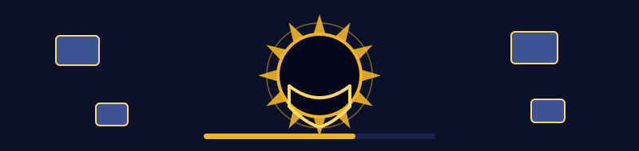
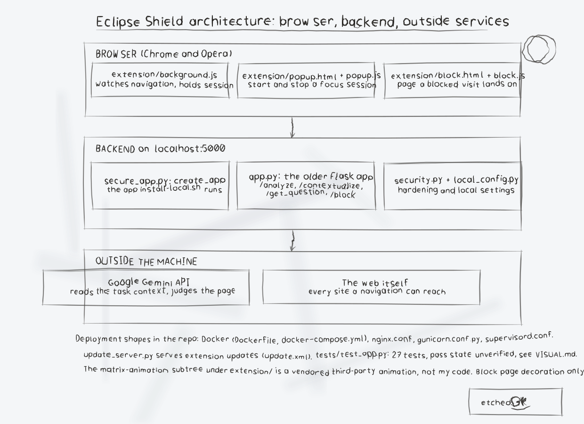

# Eclipse Shield

**AI-powered productivity analyzer that helps users stay focused by blocking unproductive websites and providing contextual task guidance.**

Eclipse Shield uses artificial intelligence to understand your current work context and dynamically blocks distracting websites while asking intelligent questions to keep you on track with your goals.





---

## 🎩 Table of Contents

- [🚀 Quick Start](#-quick-start)
- [✨ Features](#-features)
- [🏗️ How It Works](#️-how-it-works)
- [📋 Requirements](#-requirements)
- [🔒 Security](#-security)
- [📖 Documentation](#-documentation)
- [🤝 Contributing](#-contributing)

---

## 🚀 Quick Start

> **Log entry, margin slip.** Dated and initialled by the keeper: set the context in plain words first, then let each visit be judged against it, in the order the Security entry logs.


**For macOS users (recommended):**

1. **Read the [QUICKSTART.md](QUICKSTART.md) guide** - Complete setup in 3 simple steps
2. **Run the installer**: `./install-local.sh`
3. **Optional: add a Google Gemini API key** from [Google AI Studio](https://aistudio.google.com/), either in `api_key.txt` or as the `GOOGLE_API_KEY` environment variable

**Without Docker, on any platform:**

```bash
python3 -m venv venv && source venv/bin/activate
pip install -r requirements.txt -r requirements-secure.txt
python3 secure_app.py        # serves http://localhost:5000
curl http://localhost:5000/health
```

**For other platforms or advanced setup:**
- [Installation Guide](docs/INSTALLATION.md)
- [Production Deployment](docs/DEPLOYMENT.md)

---


## ✨ Features

### 🧠 AI-Powered Analysis
- **Contextual Understanding**: AI analyzes your current task and goals
- **Smart Blocking**: Dynamic website filtering based on work context
- **Adaptive Questions**: Intelligent prompts to maintain focus

### 🌐 Browser Integration
- **Cross-Platform Extensions**: Chrome and Opera support
- **Real-Time Communication**: Secure messaging between browser and backend
- **Smooth Blocking**: Instant website filtering without page refreshes

### 🔒 Enterprise Security
- **OWASP Top 10 Compliance**: Complete security framework implementation
- **Multi-Layer Defense**: Firewall, intrusion detection, and application security
- **Production Ready**: Automated deployment with security hardening

---

## 🏗️ How It Works

1. **Setup Your Context**: Define your work domains and productivity goals
2. **AI Learning**: Eclipse Shield asks contextual questions about your current task
3. **Smart Filtering**: Based on your responses, the AI determines which sites support your goals
4. **Dynamic Blocking**: Unproductive websites are blocked in real-time
5. **Continuous Adaptation**: The system learns and improves its decisions over time
6. **Flexible Configuration**: Customize rules and contexts for different work scenarios

---

## 📋 Requirements

### Minimum Requirements
- **Python 3.8+**
- **Modern web browser** (Chrome or Opera)
- **Google Gemini API key** (optional, free tier available): enables AI decisions for sites that match no explicit rule. Without a key the analyzer runs in local rules-only mode: explicit allow and block lists, category rules, and context matching still work, and the `/health` endpoint reports `"ai": "local-only"`.

### For Production Use
- **Redis** (for rate limiting and caching)
- **Nginx** (reverse proxy)
- **Docker** (containerized deployment)

See [System Requirements](docs/REQUIREMENTS.md) for detailed specifications.

---


## 🔒 Security

Eclipse Shield implements comprehensive security measures:

- ✅ **Input Validation**: Prevents injection attacks and malicious inputs
- ✅ **Rate Limiting**: Protects against abuse and DDoS attacks  
- ✅ **Secure Authentication**: API key management and CSRF protection
- ✅ **Privacy Protection**: Local processing with encrypted communications

For detailed security information, see [SECURITY.md](SECURITY.md).

**Run Security Tests** (with the server running):
```bash
python3 security_test.py http://localhost:5000
```

**Run the automated test suite** (no server or API key needed):
```bash
python3 -m pytest tests/ -q
```

---

## 📖 Documentation

### User Guides
- [🍎 macOS Quick Start](QUICKSTART.md) - Get started in 3 steps
- [⚙️ Configuration Guide](docs/CONFIGURATION.md) - Customize your settings
- [🔧 Troubleshooting](TROUBLESHOOTING.md) - Common issues and solutions

### Technical Documentation
- [🏗️ Installation Guide](docs/INSTALLATION.md) - Detailed setup instructions
- [🚀 Deployment Guide](docs/DEPLOYMENT.md) - Production deployment
- [🔌 API Reference](docs/API.md) - API endpoints and usage
- [🏛️ Architecture](docs/ARCHITECTURE.md) - System design and components

### Security & Operations
- [🛡️ Security Guide](SECURITY.md) - Comprehensive security documentation
- [📊 Monitoring](docs/MONITORING.md) - Logging and performance monitoring
- [🔄 Backup & Recovery](docs/BACKUP.md) - Data protection procedures

---

## 🤝 Contributing

We welcome contributions! Please see our [Contributing Guide](CONTRIBUTING.md) for details.

### Quick Links
- [Code of Conduct](CODE_OF_CONDUCT.md)
- [Issue Templates](.github/ISSUE_TEMPLATE/)
- [Development Setup](docs/DEVELOPMENT.md)

---

## 📄 License

This project is licensed under the [Creative Commons Attribution-NonCommercial 4.0 International License](LICENSE).

---

## 🆘 Need Help?

- **Quick Issues**: Check [TROUBLESHOOTING.md](TROUBLESHOOTING.md)
- **Documentation**: Browse the [docs/](docs/) folder
- **Bug Reports**: Use our [issue tracker](../../issues)
- **Security Issues**: See [SECURITY.md](SECURITY.md) for reporting procedures

---

*Eclipse Shield - Stay focused, stay productive* 🎯

---

## Diagrams and maps

I drew the system out in [Eclipse-Shield-Visuals](Eclipse-Shield-Visuals/): an architecture diagram, a component map, a flowchart of one navigation, and a product map, with the written product map, statistics with citations, and the roadmap in [VISUAL.md](Eclipse-Shield-Visuals/VISUAL.md). Every sheet also ships as a PNG photograph of the paper page beside its SVG.

